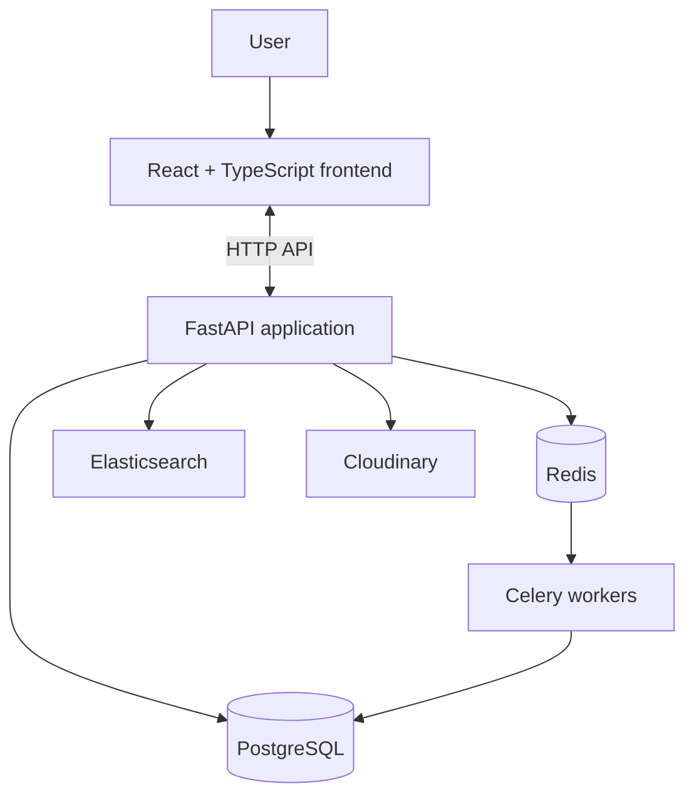

<!--
  CRUD API README refresh.
  Documentation-only change: README.md is the only file being updated.
-->

<div align="center">

  

  <p><strong>A full-stack social application built with FastAPI and React.</strong></p>
  <p>Profiles · Posts · Social interactions · Messaging · Notifications</p>

  <p>
    <a href="https://crud-api-1-s7wp.onrender.com"></a>
    <a href="https://crud-api-0b8d.onrender.com"></a>
    <a href="https://crud-api-0b8d.onrender.com/docs"></a>
  </p>

  <p>
    
    
    
    
    
    
    
  </p>

  <p><em>From API fundamentals to the building blocks of a social product.</em></p>

</div>

---

## 🌐 Live application

| Component | Link |
| --- | --- |
| React frontend | [crud-api-1-s7wp.onrender.com](https://crud-api-1-s7wp.onrender.com) |
| FastAPI backend | [crud-api-0b8d.onrender.com](https://crud-api-0b8d.onrender.com) |
| Interactive API documentation | [Swagger UI](https://crud-api-0b8d.onrender.com/docs) |

> The project is deployed on Render. Availability and response times may depend on the hosting plan and service state.

## ✨ Overview

**CRUD App** is a full-stack social-media-style application built with a Python **FastAPI** backend and a **React + TypeScript** frontend.

The project goes beyond basic create, read, update and delete operations. Its documented feature set covers user accounts, social relationships, posts and interactions, stories, direct messaging, notifications, media uploads, caching, background processing and search infrastructure.

It is also a practical backend engineering project: it brings together API development, relational data modelling, authentication, database migrations, asynchronous tasks and integrations with supporting services.

## 🚀 Features

### Backend and API

- FastAPI application with interactive OpenAPI documentation.
- OAuth2/JWT authentication.
- User accounts and permission-related functionality.
- Posts, comments, votes and bookmarks.
- Followers and social relationships.
- Stories.
- Direct messaging and notification components.
- Media upload integration with Cloudinary.
- SQLAlchemy ORM and PostgreSQL.
- Alembic database migrations.

### Supporting infrastructure

- Redis caching and Pub/Sub components.
- Celery background tasks and Celery Beat scheduling.
- Elasticsearch search and indexing components.
- WebSocket-related infrastructure.
- Nginx configuration.
- Docker and Docker Compose support.

### Frontend

- React with TypeScript and Vite.
- Responsive social application interface.
- Authentication and user profiles.
- Posts and social interactions.
- Stories, messaging and notifications.
- Media-related interface components.

> **Implementation status:** The repository contains application code and infrastructure components at different stages. The currently deployed application should be treated separately from experimental or planned components. In particular, livestreaming is not currently deployed or production-ready.

## 🧭 Architecture

The high-level architecture documented for the project is:



This diagram represents the project's documented technology components and intended integration areas. It is a conceptual overview, not a guarantee that every component is active in the current Render deployment.

## 🧰 Technology stack

| Layer | Technology | Purpose |
| --- | --- | --- |
| Language | Python | Backend application |
| API framework | FastAPI | HTTP API and OpenAPI documentation |
| ORM | SQLAlchemy | Relational data access |
| Migrations | Alembic | Database schema migrations |
| Database | PostgreSQL | Persistent application data |
| Authentication | OAuth2 / JWT | API authentication |
| Cache and messaging | Redis, Redis Pub/Sub | Caching and message distribution components |
| Background jobs | Celery, Celery Beat | Asynchronous and scheduled task components |
| Search | Elasticsearch | Search and indexing components |
| Media | Cloudinary | Media storage integration |
| Frontend | React, TypeScript, Vite | Web application |
| WebSocket | WebSocket infrastructure | Real-time feature foundation |
| Reverse proxy | Nginx | Web server / proxy configuration |
| Containers | Docker, Docker Compose | Containerization support |
| Hosting | Render | Current web deployment |

## 🗂️ Repository structure

The following is a condensed view based on the repository's documented structure:

```text
CRUD_cleaned/
├── alembic/                 # Database migrations
├── app/
│   ├── routers/             # API route modules
│   ├── tasks/               # Background task modules
│   ├── uploads/             # Upload-related components
│   ├── models.py            # SQLAlchemy models
│   ├── schemas.py           # API schemas
│   ├── database.py          # Database configuration
│   ├── main.py              # FastAPI application entry point
│   ├── celery_app.py        # Celery configuration
│   ├── redis_cache.py       # Redis cache components
│   ├── elastic.py           # Elasticsearch integration
│   └── livestream.py        # Early livestreaming implementation
├── nginx/                   # Nginx configuration
├── react/                   # React frontend
├── tests/                   # Backend tests
├── Dockerfile
├── docker-compose.yml
├── render.yaml
├── requirements.txt
└── start.sh
```

## 🛠️ Local development

The repository includes a backend, frontend and supporting infrastructure. The steps below provide a starting point; check the current configuration files and environment variables for the exact values required by your checkout.

### Prerequisites

- Python
- Node.js and npm
- PostgreSQL
- Git

Redis, Elasticsearch and other supporting services are required only when running the features that depend on them.

### 1. Clone the repository

```bash
git clone https://github.com/dieudonne670/crud-api.git
cd crud-api
```

### 2. Create a Python virtual environment

```bash
python3 -m venv .venv
source .venv/bin/activate
```

On Windows PowerShell:

```powershell
.venv\Scripts\Activate.ps1
```

### 3. Install backend dependencies

```bash
pip install -r requirements.txt
```

### 4. Configure environment variables

Configure the database connection, authentication secrets and any external service credentials required by the features you intend to run.

Use a local environment file if supported by the project. Never commit real passwords, API keys, tokens or production credentials.

### 5. Run database migrations

The project uses Alembic. Review the migration configuration and database URL, then apply migrations:

```bash
alembic upgrade head
```

### 6. Start the FastAPI backend

The application entry point documented by the repository is `app.main`:

```bash
uvicorn app.main:app --reload
```

Open the interactive API documentation at:

[http://127.0.0.1:8000/docs](http://127.0.0.1:8000/docs)

### 7. Start the React frontend

Open a separate terminal and enter the frontend directory:

```bash
cd react
npm install
npm run dev
```

The Vite development server will print its local URL in the terminal.

## 🧪 Testing

The repository documents the use of:

- **pytest** for automated backend tests.
- **cURL** for direct HTTP API checks.
- **Postman** for endpoint and authentication workflows.
- **FastAPI Swagger UI** for interactive API exploration.

Run the test suite from the backend project environment:

```bash
pytest
```

The actual test coverage and available test configuration should be checked in the current `tests/` directory.

## 🎥 Livestreaming: development status

The repository contains an early livestreaming/RTMP implementation, including livestream-related backend code and Nginx RTMP configuration.

**Livestreaming is not currently deployed or production-ready.** The implementation has not yet been connected to OBS in the production environment, and there is no live RTMP/HLS streaming service running on the current Render deployment.

The components remain a foundation for future exploration. A complete streaming deployment would require additional infrastructure, media-server configuration, capacity planning and operational testing.

## 🔐 Security notes

For local development and any future production deployment:

- Keep database passwords, JWT signing secrets and third-party API keys outside source control.
- Use separate development and production credentials.
- Validate and authorize access to user-owned resources on the backend.
- Apply appropriate upload validation and storage access controls.
- Configure CORS for the intended frontend origins rather than allowing every origin in production.
- Use HTTPS for deployed API and frontend traffic.
- Apply rate limits and sensible request-size limits to public endpoints.
- Keep dependencies updated and review security advisories.
- Protect logs from accidentally recording tokens, passwords or sensitive personal data.

These are recommended operational practices, not claims that every control is currently implemented.

## 🛣️ Roadmap

The project's documented longer-term direction includes:

- [ ] Complete and productionize livestreaming with OBS and RTMP/HLS.
- [ ] Improve frontend usability and overall UI/UX.
- [ ] Develop dedicated Android and iOS applications.
- [ ] Move production infrastructure toward AWS.
- [ ] Improve scalability, monitoring and observability.
- [ ] Expand real-time communication capabilities.
- [ ] Improve media processing and storage workflows.
- [ ] Expand search and recommendation capabilities.
- [ ] Strengthen security, performance and automated testing.
- [ ] Introduce and improve CI/CD workflows.

The roadmap describes future goals; it should not be interpreted as a list of currently available production features.

## 💡 Engineering areas demonstrated

This project provides practical experience with several backend engineering concerns:

- Designing REST APIs with FastAPI.
- Modelling relational data with SQLAlchemy and PostgreSQL.
- Managing schema changes with Alembic.
- Implementing token-based authentication.
- Integrating caching and background task infrastructure.
- Connecting a typed React frontend to a Python API.
- Organizing a multi-component application.
- Documenting deployment boundaries and unfinished infrastructure honestly.

## 👨‍💻 Author

**Kindong Dieudonne**  
Software Engineering graduate · Python Backend Developer

- GitHub: [@dieudonne670](https://github.com/dieudonne670)
- LinkedIn: [Kindong Dieudonne](https://www.linkedin.com/in/kindong-dieudonne-826ba9328/)

---

<div align="center">

  <p><strong>Thanks for exploring CRUD App!</strong></p>
  <p><sub>Built with Python, FastAPI and React — exploring the foundations of a connected social application.</sub></p>

</div>
